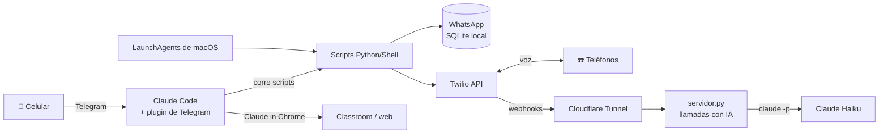

# 🤖 Asistente personal con IA (Telegram + WhatsApp + llamadas)

*[English below](#-english)*

Un asistente personal que corre en una Mac y se controla desde el celular por **Telegram**. Usa **Claude Code** (Anthropic) como cerebro y una serie de scripts pequeños para conectarse con WhatsApp, Google Classroom, Spotify y el teléfono.

> Proyecto personal hecho por un estudiante de preparatoria (IB) para aprender automatización con IA.

## ¿Qué hace?

| Área | Funciones |
|---|---|
| 💬 **Telegram** | Chat y notas de voz (transcripción local con Whisper, respuestas con voz) |
| 📞 **Llamadas con IA** | Llama a negocios por ti (horarios, reservaciones) y te manda el resumen · recordatorios por llamada · llamada de la mañana con tus pendientes · le llamas y platicas con él |
| 📱 **WhatsApp** | Avisos de mensajes, mensajes programados, "modo fuera" con respuesta automática, buscar en chats viejos, a quién no le has contestado |
| 📚 **Escuela** | Revisa y entrega tareas de Google Classroom (vía Claude in Chrome) |
| 💰 **Oportunidades** | Busca becas, concursos y chambas de IA (vacantes públicas de LinkedIn) y las clasifica |
| 📄 **CV automático** | Mantiene el CV al día y lo genera en PDF en español e inglés |
| 🎵 **Música** | Controla Spotify y conecta bocinas Bluetooth |
| 🛠️ **Mantenimiento** | Se revive solo si se cae, respaldo diario, bloquea la compu a distancia |

## Cómo funciona



- **Cerebro:** Claude Code con el plugin oficial de Telegram. Las instrucciones viven en un `CLAUDE.md` (ver `CLAUDE.example.md`).
- **Cero tokens cuando se puede:** lo repetitivo (recordatorios, vigilar WhatsApp, buscar chambas, generar PDFs) lo hacen scripts con `LaunchAgents`, sin gastar uso de IA.
- **Llamadas:** `llamadas/servidor.py` recibe los webhooks de Twilio por un túnel de Cloudflare, valida la firma de Twilio, convierte la voz en texto (`<Gather>` de Twilio) y responde con Claude Haiku turno por turno.
- **Seguridad:** el bot solo responde a una cuenta de Telegram (allowlist); nada se manda, entrega o llama sin un "sí" explícito; las claves viven en archivos locales con permisos `600`, nunca en el código.

## Estructura

```
iniciar-bot.command      arranca el bot (Terminal) y sus ayudantes
llamadas/                servidor de llamadas con IA, llamadas salientes, recordatorios
whatsapp/                vigilante, mensajes programados, modo fuera, sin contestar
oportunidades/           cazador de chambas de IA (LinkedIn)
cv/                      generador de CV en PDF
voz/                     transcribir (Whisper) y hablar (voz de macOS)
musica/                  Spotify y bocinas Bluetooth
manual/                  manual del bot en Telegram y PDF
mantenimiento/           revivir el bot, respaldo diario
```

## Configurarlo

1. Instala [Claude Code](https://claude.com/claude-code) y el plugin `telegram@claude-plugins-official`.
2. Copia `.env.example` y llena tus datos (chat de Telegram, nombre). Las claves de Twilio van en `~/claude-telegram/.twilio.env`.
3. Escribe tu `CLAUDE.md` a partir de `CLAUDE.example.md`.
4. Corre `iniciar-bot.command`.

Probado en macOS (Apple Silicon). Algunas partes dependen de la Mac: WhatsApp de escritorio, permisos de Acceso total al disco y Accesibilidad.

---

## 🇺🇸 English

A personal assistant that runs on a Mac and is controlled from my phone through **Telegram**. **Claude Code** (Anthropic) is the brain, plus small scripts that connect it to WhatsApp, Google Classroom, Spotify and the phone network.

**Highlights**
- 📞 **AI phone calls (Twilio):** calls businesses on my behalf and sends me a summary, reminder calls, a morning call with my to-dos, and I can call it to talk.
- 📱 **WhatsApp automation:** alerts, scheduled messages, auto-reply when I'm away, search old chats.
- 📚 **School:** checks and submits Google Classroom assignments.
- 💰 **Opportunity radar:** scholarships, competitions and AI gigs, sorted by category.
- 📄 **Auto CV:** keeps my résumé updated and builds PDFs in Spanish and English.
- 🛠️ **Self-healing:** restarts itself, nightly backups, remote screen lock.

**How it works:** Telegram → Claude Code → Python/shell scripts. Repetitive jobs run as macOS LaunchAgents with zero AI tokens. Phone calls go Twilio → Cloudflare Tunnel → `servidor.py` (validates Twilio signatures) → Claude Haiku, turn by turn.

**Safety:** single-user allowlist, nothing is sent, submitted or called without explicit confirmation, secrets stay in local `chmod 600` files.

*Built by a high-school (IB) student learning AI automation.*
